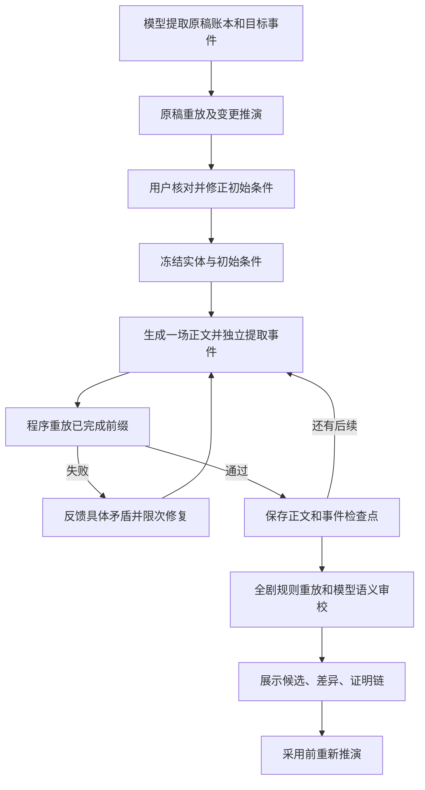

# 剧情事件与逻辑推演设计

2026-11-08。当前实现为“模型提取与创作 + 确定性事件推演 + 语义审校”。操作及接口见 [使用说明](PLOT_REVISION_GUIDE.md)。

## 表示与职责

`logic_models.py` 定义严格的实体、事实、初始条件、事件、正文覆盖和证明模型。角色、物品、地点、秘密使用稳定 ID。事实键为 `(subject, predicate, target)`；内置谓词为 alive、available、at、owner、knows、contains、relationship；额外状态使用已声明的 custom: 命名空间与有限值域。

`logic_engine.py` 不调用模型。World 执行已定义状态转移，reason_story 按顺序重放。事实缺失为 unknown，值不符为 false，相同为 true；只有全部前提为 true 才原子提交效果。失败事件不会留下部分更新。requires 可以增加前提，不能绕过核心规则。模型不能提交任意可执行代码。

| 事件 | 核心前提 | 效果 |
| --- | --- | --- |
| death | 存活且可行动 | alive=false，available=false |
| exit | 存活且可行动 | available=false |
| revive | alive=false | alive=true，available=true |
| return | 存活且 available=false | available=true |
| transfer | 双方可行动、同地；交出者持有物品 | 唯一持有人改为接收者 |
| move | 可行动、原地点已知、目的地有效 | at 改为目的地 |
| learn | 可行动；唯一来源是同地可行动的知情者，或本人持有且记载秘密的物品 | knows(secret)=true |
| relationship | 两个不同角色均可行动 | 双向 ally/enemy/neutral |
| custom | 已确认规则的前提、参与者限制与所有内置步骤成立 | 额外状态效果及内置步骤效果，整件事原子提交 |
| act / use_item | 可行动；use_item 还需持有物品；全部 requires 成立 | 不自动创造新事实 |

用户死亡/离场事件锁定对应状态；只有后续明确批准的复活/回归可更新它。初始关系自动补齐对称方向，矛盾的双向值被拒绝。owner 是单值，不能双重持有。

## 证据、时间和因果

每个事件必须引用当前场景的逐字正文 `scene_id / element_index / quote`。覆盖表恰好覆盖每个正文元素，声明包含的事件或仅为环境/提及。程序另为对白和未被事件覆盖的在场人物检查行动资格。事件 ID 唯一；保留引擎内部前缀，禁止伪造。

每个初始事实必须有引用或标为假设，二者都由用户在生成前核对。服务端捕获引用原文快照与版本摘要，随后冻结实体、初始事实、自定义属性/规则及依据；正文改写不会抹掉初始出处。账本修正创建新计划 ID，运行中的计划不变，再次确认后才能生成。

证明步骤保存每个前提的期望、实际值、三值状态和 established_by，以及成功效果和 causes。状态更新记录生产事件，依赖沿前提来源形成图，再投影到场景。

在交信前插入 A 死亡，转交失败 → B 不持有信 → B 学习失败 → C 的来源不成立 → C 的判断缺少 knows 前提。计划比较原稿和插入事件后的重放结果，结合模型提取的其他依赖扩大改写范围；所有后续场景仍逐一检查。

历史场景从锚定的更早场景开始时快照重放，效果不写回当下。普通事件按场景、正文元素、账本内顺序执行；同场多个用户事件按指令顺序置于场末。复活与随后对白应拆成先后两个元素。混合时间线应拆场。

## 生成与版本保护

原稿账本和本次事件本身必须通过；变更后的下游失败用于指导改写。逐场生成只能替换 SceneLogic，不能改初始条件。模型返回空 issues 不是充分条件；目标事件必须真实提取且执行成功。每场最多两次生成；未解决的问题保留为 needs_review，禁止采用。

`plot_state.logic` 随 YAML 保存账本；候选 `reasoning` 保存证明。SQLite 检查点保存已完成正文和事件、调用数、时间及尝试次数。采用从服务端记录重算，同时核对冻结前提和内容哈希。旧计划可读，生成须重新规划；旧版本仍可回退。

AI 局部润色对已有账本重新提取和重放，要求该场结束时状态不变；状态变更应走剧情改写。本地演示若修改正文会提示改用 AI，纯镜头提示可直接重检。RAG 使用原小说独立索引；改写上下文提供当前前缀的有效事实与证明，原小说不能覆盖改编约束。

## 能力边界

能保证的是：给定事件账本和已确认初始条件，规则执行一致、失败原子性、未知不通过、来源可追溯、历史不污染当下、规则失败不能采用。这是有限事件域推演器，不是开放世界自然语言的通用完备推理系统。

逐字引用只验证出处存在，不证明语义蕴含。“听说他也许知道”不能当成确定知道。模型可能漏提动作、误标为背景，或未给使用线索的行动添加 knows 前提。覆盖表保证索引覆盖，不保证语义完整。引用是否真的说明故事开始前的状态，需要作者核对和模型语义审校。

自定义规则现支持有限额外状态、双向关系、参数绑定、行动/物品使用限制及组合内置步骤；如物品损毁，可定义完好状态并限制损毁物品的使用。暂未内置物理距离、旅行时间、场景标题与位置的全部语义对应、谎言/置信度、遗忘、假死、制造/拾取、死者遗物自动接管、同场多时间线、分支合并及任意条件规划。转交需活跃的交出者，不能把死者交物当成合法转交。生成阶段不能临时扩展实体表。真实模型抽取与创作质量需独立评测。

## 代码与测试

核心：logic_models.py、logic_engine.py、logic_integration.py。流程：plot_revision.py、plot_state.py、plot_models.py、plot_store.py、plot_jobs.py、plot_api.py、static/plot.js。

`tests/test_logic_engine.py` 独立于模型验证规则、来源、未知、原子性、因果链、时间快照和结构门禁。`tests/test_plot_revision.py` 使用模拟模型验证全流程、恢复、冻结前提、非死亡事件和对抗审校。验证记录见 [验证报告](LOGIC_ENGINE_VALIDATION.md)。

## 自定义事件扩展

2026-11-08 新增 `custom_events.py`。规则在规划阶段编译、检查并确认，正文提取阶段只能实例化已有规则。内置状态必须通过内置步骤更新，组合事件失败不提交任何效果；新计划保留历史规则，旧无扩展字段的内容哈希保持兼容。完整协议、例子与边界见 [CUSTOM_EVENTS.md](CUSTOM_EVENTS.md)。
