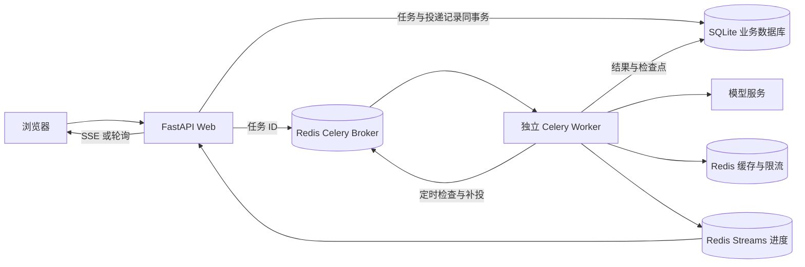

# Redis 与独立 Worker 使用说明

更新日期：2026-11-08。已接入 Celery + Redis 任务队列、共享 LLM/Embedding 缓存、全局请求速率限制、跨进程进度流及数据库补投机制。原有 local 模式继续可用。

## 架构与数据归属



数据库继续保存小说输入、任务真实状态、剧本版本、事件账本、草稿与检查点。Redis Broker 消息只有任务类型、ID、执行代次和数据库部署标识，不携带整篇正文或任意文件路径。缓存和进度流可能包含生成结果及正文片段，所以仍应作为项目私有数据管理。

**当前范围是同主机多进程。** Web 与 Worker 必须使用同一个本地 SQLite 文件、同一份项目和供应商配置。执行互斥仍用本机文件锁，状态用数据库版本更新。跨机器 Worker、容器内外各一份数据库、不共享配置的部署不在本版支持范围，需先迁移 PostgreSQL/MySQL 和相应执行租约。

## Windows 快速启动

在项目目录中使用同一个 Python 环境。项目已新增可选依赖组：

```powershell
python -m pip install -e ".[dev,redis]"
docker compose -f compose.redis.yml up -d
```

打开一个终端启动 Worker：

```powershell
.\scripts\run_redis.ps1 -Mode worker -Python 'D:\anaconda\envs\story2script\python.exe' -Concurrency 2
```

另一个终端启动 Web：

```powershell
.\scripts\run_redis.ps1 -Mode web -Python 'D:\anaconda\envs\story2script\python.exe' -Port 8000
```

使用已经激活的环境时可省略 -Python。脚本只设置启动进程的环境变量，不覆盖现有供应商 `.env`；不改变系统级设置。AI 模型仍使用已有配置。脚本启动的是前台服务，关闭对应终端会结束它；Web 与 Worker 的生命周期独立。

默认 Redis 只绑定 `127.0.0.1:6379`。若 Windows 端口保留或占用，可使用其他端口，例如：

```powershell
$env:STORY2SCRIPT_REDIS_PORT = '16379'
docker compose -f compose.redis.yml up -d
# 启动 Web 和 Worker 时都传相同 RedisPort
.\scripts\run_redis.ps1 -Mode worker -RedisPort 16379
# 另一终端
.\scripts\run_redis.ps1 -Mode web -RedisPort 16379
```

若已有 STORY2SCRIPT_REDIS_URL，脚本保留它，-RedisPort 不覆盖已配置 URL。Compose 只有 Redis 容器，Web 与 Worker 在主机 Python 环境运行。

Linux/macOS 或手动启动：将 [config/redis.env.example](../config/redis.env.example) 中参数导出为环境变量，修改 JOBS_DB 为真实绝对路径，然后分别执行：

```bash
python -m story2script.worker --concurrency 2
python -m uvicorn story2script.main:app --host 127.0.0.1 --port 8000
```

`python -m story2script.worker` 启用 Redis 任务后端；Web 需要显式设置 STORY2SCRIPT_TASK_BACKEND=redis。不要只启动 Worker 却让 Web 仍用 local。基础设施配置使用环境变量，供应商配置页面不会替你设置 Redis 或启动 Worker。

## 验证已启用

进入“运行指标”点击刷新，可以看到：

- 任务后端 redis、缓存 redis。
- Redis 已连接。
- 在线 Worker 至少 1。
- 等待确认的投递数、生成/向量请求 RPM。

同样信息可从 `GET /api/infrastructure` 获取，接口不返回 Redis URL、密码或供应商 Key。配置 API Token 后仍按现有认证规则保护。

在线 Worker 是短时心跳状态；没有 Worker 时任务保持排队。下面的 LLM/任务指标仍是当前 Web 进程统计，**没有假装聚合所有 Worker 的调用指标**。完整任务结果和历史通过数据库查询，跨进程可见。

## 任务投递与故障恢复

创建任务时，在一个 SQLite 事务中写 jobs 和 job_outbox，之后才尝试发给 Redis。投递失败不丢弃任务，也不会在 Web 进程偷偷执行：保持 queued 并显示“任务已保存等待补投”。

Worker 内有补投循环，每 5 秒检查数据库。每个未完成投递按配置间隔重新发布，默认 60 秒；同任务重复消息可能出现，但本机执行锁、状态检查和 generation 代次校验阻止重复应用结果。终态与删除投递记录在同一事务中完成。

Celery 配置迟确认、Worker 退出后重投、每进程预取 1。即使 Redis 消息丢失、Web 在保存后发消息前退出，也能从数据库补投。Worker 意外退出后 OS 释放执行锁，新的 Worker 可继续已有任务。恢复仍遵守原有最多三次执行、检查点、调用与时间预算。

手动恢复会增加 generation；旧代次迟到的消息不执行新一轮任务。已完成任务的重复投递只读取终态，不重新生成。

**不承诺远端付费请求 exactly-once。** 模型已收到请求、但本地尚未存响应时进程退出，恢复仍可能重发。已保存的场景/响应检查点会复用，未保存响应无法从数据库证明是否已经计费。

Web/Worker 数据库部署标识不匹配时拒绝执行队列任务。每套项目必须使用不同 STORY2SCRIPT_REDIS_NAMESPACE；不要把相同命名空间的两个不同数据库指向同一个队列。

## 共享缓存

`STORY2SCRIPT_CACHE_BACKEND=redis` 时，响应和向量缓存直接读写 Redis，不用本地内存/磁盘旧副本绕过 TTL。默认 24 小时到期；单个缓存值默认最多 2MB，超出则不缓存。

缓存键包括供应商地址、账号 Key 的哈希、模型与请求参数、Prompt 版本及内容等。不同账号/项目不能凭相同提示误命中同一个键。Key 明文不出现在 Redis 键名。项目目前没有多租户账户系统；若以后开放多用户，还需把用户/租户权限范围加入隔离策略。

缓存命中不消耗模型限流额度；重新生成和剧情改写继续 use_cache=false，主动绕过生成缓存。缓存故障按“未命中”处理，记录警告后可正常请求模型；不把缓存当正式存储。并发首次相同请求仍可能同时产生调用，本版没有实现请求合并 single-flight。

## 全局模型限流

- STORY2SCRIPT_LLM_RPM：同供应商账号每分钟生成请求数。
- STORY2SCRIPT_EMBED_RPM：同账号每分钟向量批请求数，独立计数。
- 0 表示禁用；启动脚本默认 60 / 120，可由已有环境变量覆盖。

Redis Lua 使用服务器时间原子执行固定窗口计数，所有 Worker 共享。限额按供应商地址与账号划分，同账号多个生成模型共享额度。命中上限时返回带 429 标记的错误，不发远端请求；不是无限等待队列。已有任务可按预算和恢复流程重试。

启用了限流而 Redis 不可用时拒绝本次模型请求，避免静默失去限额保护；缓存故障与限流故障采取不同处理。这里控制的是请求次数，不是 Token 配额、同时在途数或供应商实际账单。

## 共享进度流

Redis 模式的转换 SSE 从 Redis Streams 读取，Web 与 Worker 不必在同一个进程。事件按 job_id/generation/attempt 分流，默认保留最多 1000 条、24 小时到期。执行重启后不会混用前一次尝试的场景。

流为空、过期或 Redis 连接失败时，最终状态和完整剧本仍从数据库获得；浏览器流提前关闭会退回状态轮询。进度缓存不负责长期审计，正式结果和剧情检查点不随流过期。

## 配置表

| 配置 | 默认/说明 |
| --- | --- |
| STORY2SCRIPT_TASK_BACKEND | local；显式设 redis 才切换任务执行方式 |
| STORY2SCRIPT_REDIS_URL | redis://127.0.0.1:6379/0；支持 rediss，证书校验保持开启 |
| STORY2SCRIPT_REDIS_NAMESPACE | story2script；隔离队列、缓存、进度、限流与心跳 |
| STORY2SCRIPT_JOBS_DB | 同主机 Web/Worker 必须指向相同绝对路径 |
| STORY2SCRIPT_CACHE_BACKEND | local；可单独选择 redis |
| STORY2SCRIPT_REDIS_CACHE_TTL | 86400 秒 |
| STORY2SCRIPT_REDIS_CACHE_MAX_BYTES | 2000000 |
| STORY2SCRIPT_LLM_RPM / STORY2SCRIPT_EMBED_RPM | 未设置为 0；脚本默认 60/120 |
| STORY2SCRIPT_REDIS_DISPATCH_SECONDS | 60 秒，最小 5 秒；未完成任务补投间隔 |
| STORY2SCRIPT_REDIS_EVENT_TTL / LIMIT | 86400 秒 / 1000 条每任务尝试 |
| STORY2SCRIPT_REDIS_VISIBILITY_TIMEOUT | 14400 秒；Celery Broker 的未确认消息时间 |

Compose 启用 AOF、everysec 和 noeviction，避免队列被普通缓存淘汰。达到 256MB 上限时写入可能失败，缓存可重建，任务留在数据库等待补投；应根据实际负载调整内存或拆分 Redis 服务。示例只绑定本机；需要远程 Redis 时自行配置网络、ACL/TLS 和适当隔离，不将此开发配置直接公开。

## 停止与回到本地模式

先停止 Web 和 Worker，避免两套执行方式混跑。然后以 STORY2SCRIPT_TASK_BACKEND=local（或清除该变量）、STORY2SCRIPT_CACHE_BACKEND=local、两个 RPM=0 启动原服务，即可继续使用同一 SQLite 数据。

```powershell
docker compose -f compose.redis.yml stop
```

stop 保留 Redis 数据卷。不要用 down -v 清理正式数据，除非明确要删除它。SQLite 业务库需独立备份，Redis AOF 不替代业务数据库备份。

本轮验证见 [REDIS_VALIDATION.md](REDIS_VALIDATION.md)，包含真实 Redis、独立 Worker、数据库补投、Worker 中途退出恢复及跨进程缓存/限流测试。
