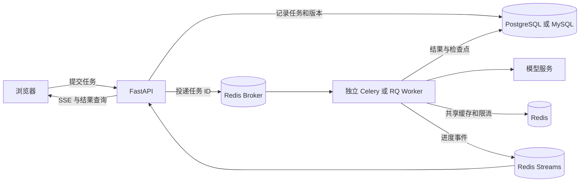

# 后台任务 数据库与 Redis 的作用和升级路径

核对日期：2026-11-08。本文同时记录当前状态与后续架构建议。现有任务层可靠性和创作后台任务已完成，见 [任务层使用说明](TASK_LAYER_GUIDE.md)；现已可选接入 Redis/Celery，同主机独立 Worker 可运行，见 [REDIS_GUIDE.md](REDIS_GUIDE.md)；PostgreSQL/MySQL 迁移尚未进行。

## 当前实现

| 职责 | 当前代码 | 当前范围 |
| --- | --- | --- |
| 后台任务 | DurableJobStore；local 使用线程池，redis 使用 Celery + outbox | 落盘后返回 job_id；可选独立 Worker、本机执行锁、代次去重和消息补投 |
| 长期保存 | SQLite，默认 .story2script/jobs.db | 任务、计划、候选、正文与事件检查点、创作草稿/历史、模板版本；部分 Agent 会话另存 JSON 文件 |
| 模型缓存 | local 使用 LRU/可选磁盘，redis 使用共享 TTL 缓存 | 响应/Embedding 按模型、参数、账号和内容隔离；重新生成绕过响应缓存 |
| 实时进度 | local 进程内订阅；redis 使用限长/限时 Streams | Redis 模式可跨 Web/Worker 进程，流故障退回数据库轮询；正式结果不依赖进度缓存 |
| 创作面板耗时操作 | studio_api.py 的 AI 分组、情绪分析、重提事件/全剧检查 | AI 模式已统一为返回 202 的后台任务，保存模型响应检查点，支持恢复、预算和任务历史 |

已修正普通任务层的静默内存降级：提交、进度和结果必须成功写入数据库，失败返回 503 或中止后台执行，不报告未保存的成功结果。恢复仍受检查点边界和远端模型请求的不确定性限制。

任务恢复使用同主机 OS 文件锁、执行代次和数据库版本检查；Redis 模式已提供跨进程事件流和供应商全局请求限流。正式业务数据库仍是 SQLite，同主机 Web/Worker 必须使用相同文件；本版不支持跨机器任务执行。

## 各组件解决什么问题

### 后台任务与独立 Worker

小说改编可能需要几十次模型调用。如果把整个过程绑在一个 HTTP 请求上，用户等待时间长，断线后也不容易查询执行到了哪里。后台任务接口应先确认任务已记录并返回 job_id，浏览器再用它查询进度和结果。

Celery、RQ 等任务系统把真正的工作交给独立 Worker。Web 服务负责接收请求与展示结果，Worker 负责生成、审校、导出等长耗时工作。这样可以分别部署、限流、扩容和重启。async def/asyncio 负责程序的并发等待，本身不提供持久化排队、跨进程恢复和可靠调度。

这会改善请求体验和系统吞吐量，不会自动减少单次模型生成的计算时间。并行仍受供应商限流、上下文依赖和费用预算约束。

### 关系数据库

数据库保存不可丢失的业务记录：作品与用户归属、任务状态、剧本版本、草稿历史、采用记录、已确认事件及其证据。SQLite 已能满足本机和低并发场景，无需额外服务。

多人使用、多个 Worker 同时写入、复杂作品查询或跨机器部署时，可通过统一存储接口迁移到 PostgreSQL；团队已有 MySQL 经验也可以选择 MySQL。SQLAlchemy 是访问关系数据库的工具，不是另一种数据库；迁移还需要表结构版本管理，例如 Alembic。

## Redis 不只是缓存

| 用途 | 在本项目中的例子 | 与长期数据的关系 |
| --- | --- | --- |
| 任务 Broker | Redis 接收 job_id，Celery/RQ Worker 领取执行 | 数据库保留任务真实状态；不能只把整篇小说放在临时队列中 |
| 共享缓存 | 相同小说内容/模型的 Embedding，已验证同请求结果 | 可丢失和重建；设置过期、版本键和容量上限，不替代剧本版本库 |
| 全局限流 | 多个 Worker 合计每分钟只能调用供应商一定次数 | 防止每个进程各自限流后，总量仍超过供应商配额 |
| 进度传递 | 生成 Worker 发出“第 8 场完成”，Web 进程转发给浏览器 | Pub/Sub 无订阅者时会丢消息；需补发时使用 Streams 或持久化事件记录 |
| 短时协调 | 防止同一任务同时被不同 Worker 处理 | 锁不是业务正确性的唯一保障；仍需数据库条件更新、任务幂等与提交去重 |

缓存键要包含足够的输入和版本信息，例如小说/剧本内容摘要、模型与参数、Prompt/模板版本；多人系统还需用户或租户隔离。用户点击重新生成时不复用旧生成结果。高频状态查询可以读 Redis，但作品、已确认规则和正式版本以数据库为准。

Redis 可配置持久化，但缓存淘汰、重启恢复和消息确认属于不同机制。仅仅安装 Redis 不会自动保证任务不丢失、不重复；持久化、重试、确认、幂等与故障测试需要一起设计。

## 可升级架构

Broker、缓存、限流和 Streams 是不同职责，可以在小规模阶段共用 Redis 服务，但命名空间、过期和淘汰策略必须区分；任务数据不能被普通缓存淘汰策略误清除。

数据库写入成功但队列投递失败也必须处理：可以用数据库 outbox 或任务扫描补投，避免任务长期停在 queued。队列重投通常要求按“可能重复执行”设计；尤其是付费模型请求，进程在收到响应但尚未保存时退出，不能承诺绝对不会重复计费。

## 建议顺序

1. 已完成：普通任务写入失败明确报错，状态先落盘再发布；AI 分幕、情绪分析、重提事件纳入后台任务，新增去重和检查点；保持本地单进程运行路径。
2. 已完成同主机执行进程拆分：可选 Celery + Redis，任务只传 ID，Worker 从 SQLite 读取输入和检查点；outbox 补投、文件执行锁、代次和状态版本保护结果。跨机器租约仍需后续设计。
3. 已完成共享资源：Embedding/响应缓存、供应商账号请求限流、限长/限时进度 Streams，验证缓存过期、命名空间/账号隔离与 Redis 故障行为；多租户权限隔离仍未引入。
4. 面向多人部署时迁移关系数据库，并实现账户/作品归属和访问控制。数据库迁移、备份与多 Worker 故障测试一起完成。

单人本机使用时，SQLite 和本地缓存仍有合理价值。以多人在线服务或后端工程展示为目标时，独立任务执行、可恢复检查点、共享限流和可测的故障处理更有意义；引入组件的依据应是明确问题，而不是依赖数量。

## 参考项目核对

本次重新检查 [ai-novel-screenplay](https://github.com/1dashboard/ai-novel-screenplay)，远端 HEAD 仍为 `67e3581f34336fb4c712c63da31fb729004dabf0`。

- [database.py](https://github.com/1dashboard/ai-novel-screenplay/blob/67e3581f34336fb4c712c63da31fb729004dabf0/backend/database.py) 可见 SQLAlchemy 和 MySQL/MariaDB 连接池配置。
- [任务模型](https://github.com/1dashboard/ai-novel-screenplay/blob/67e3581f34336fb4c712c63da31fb729004dabf0/backend/models/task.py) 保存用户归属、状态、进度、错误、文件路径与模型信息；[剧本模型](https://github.com/1dashboard/ai-novel-screenplay/blob/67e3581f34336fb4c712c63da31fb729004dabf0/backend/models/screenplay.py) 保存正文与统计信息。
- [conversion_service.py](https://github.com/1dashboard/ai-novel-screenplay/blob/67e3581f34336fb4c712c63da31fb729004dabf0/backend/services/conversion_service.py#L239) 可见 asyncio.to_thread；[stream.py](https://github.com/1dashboard/ai-novel-screenplay/blob/67e3581f34336fb4c712c63da31fb729004dabf0/backend/services/stream.py) 使用进程内队列。
- README 描述了 Redis、Celery、限流等架构，但该提交 Git 树未包含相应完整模块，不能据此称公开版本已验证这些能力。

后续批次已完善本地任务层并引入可选 Redis/Celery，真实联调已完成。下文架构中的 PostgreSQL/MySQL 仍是后续计划。运行方式、202 接口变更和恢复边界见 TASK_LAYER_GUIDE.md。
